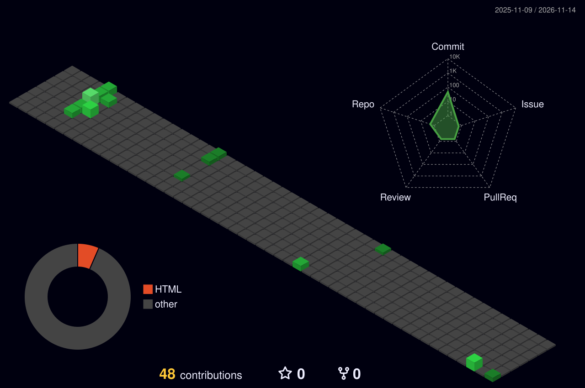

 

# `Godcoaco`

**`Cybersecurity Enthusiast | Developer | Student`**

`[ SYSTEM ONLINE ]` · `[ ACCESS GRANTED ]` · `[ KEEP LEARNING ]`

---

### `$ whoami`

I'm a computer science student interested in cybersecurity, software development, and digital forensics.

I enjoy understanding how systems work, exploring their weaknesses, building useful applications, and learning through hands-on challenges.

**Currently exploring:**
- Cybersecurity and ethical hacking
- Digital forensics and CTF challenges
- Web application security
- Software development and AI

---

### `$ ls ~/projects`

| Project | Description |
|---|---|
| **ThaiGuide** | Tourism platform using gamification and AI to improve travel experiences. |
| **Floodguard** | Flood-monitoring platform with sensor integration, real-time alerts, and interactive maps. |
| **picoCTF Writeups** | CTF walkthroughs covering Cryptography, Forensics, Reverse Engineering, and more. |

---

### `$ cat skills.txt`

  

**Cybersecurity toolkit**

Wireshark · Autopsy · CyberChef · Kali Linux · OWASP ZAP

**Areas of interest**

Digital Forensics · CTF · Web Security · Cryptography · Reverse Engineering

---

`[ END OF TRANSMISSION ]`

**Keep learning. Keep building. Stay curious.**

